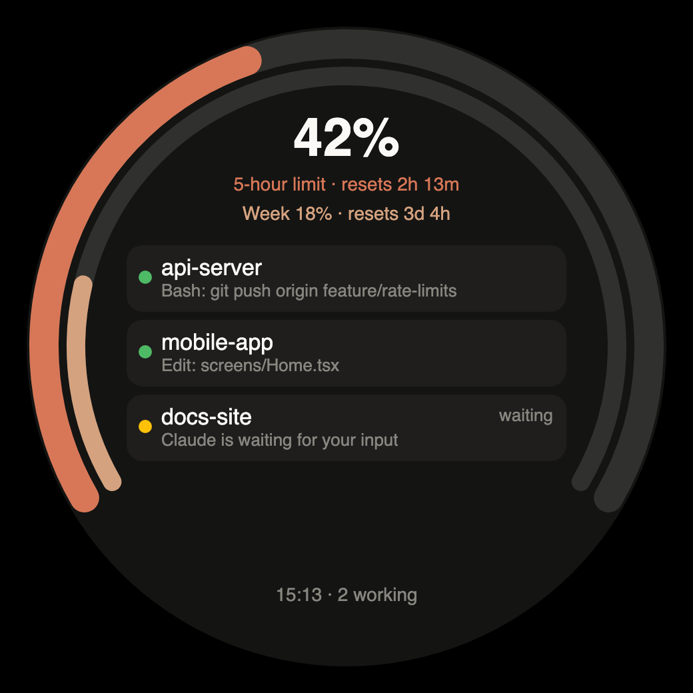
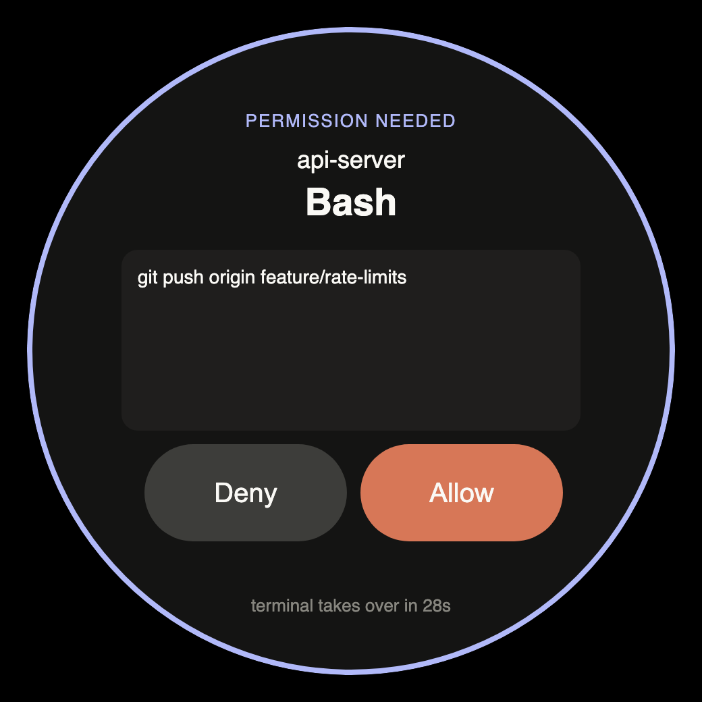

# Claude Dash

A desk display for Claude Code on the Waveshare **ESP32-S3-Touch-LCD-2.1** (480×480 round touchscreen).

<p align="center">
  
  
</p>
<p align="center"><sub>Rendered with the bridge's browser preview (demo data). The device draws the same layout in LVGL.</sub></p>

- **Usage rings**: the outer ring is the 5-hour limit, the inner ring is the weekly limit. Each shows a reset countdown.
- **Sessions**: one row per Claude Code session, showing the project folder, what it's doing (tool and command or file), and how many subagents it's running. The dot shows the state: green = working, orange = needs you, amber = waiting, grey = idle.
- **Decisions**: when Claude Code asks for permission, the display chirps and shows a full-screen **Allow / Deny** card. If you don't answer within the timeout (30 s by default), the normal terminal prompt takes over.
- **Questions**: when Claude asks a multiple-choice question, the display shows each question with its options as buttons. Single-choice questions take one tap; multi-select questions toggle options and finish with **Done**. **Skip** hands the question back to the normal prompt. The display gets 50 s (`question_timeout`).

```
Claude Code ──hooks──▶ bridge.py (your Mac, :8787) ◀──Wi-Fi── ESP32 display
   (desk-display plugin)    │  Bonjour: _claude-dash._tcp  (display finds the Mac by itself)
                            └─▶ api.anthropic.com/api/oauth/usage (usage limits)
```

## What you need

- A Waveshare **ESP32-S3-Touch-LCD-2.1** board and a USB-C cable
- A Mac with [Claude Code](https://claude.com/claude-code) and `python3` (comes with Xcode Command Line Tools)
- 2.4 GHz Wi-Fi shared by the Mac and the display

## Install

### 1. Mac: install the plugin

In Claude Code:

```
/plugin marketplace add andriitrebukhin/claude-dash
/plugin install desk-display@desk-display
```

Or from a terminal:

```bash
claude plugin marketplace add andriitrebukhin/claude-dash
claude plugin install desk-display@desk-display
```

That's all you need on the Mac. The plugin's hooks start the bridge in the background on the next Claude Code session; there's no daemon to set up. Sessions that were already open start reporting once you restart them.

- **Update:** `/plugin marketplace update desk-display`, then restart Claude Code. A running bridge keeps its old code until it restarts; to restart it now, run `kill $(lsof -t -iTCP:8787 -sTCP:LISTEN)`, and the next hook starts it again.
- **Uninstall:** `/plugin uninstall desk-display@desk-display`, and optionally delete `~/.claude-dash/`.

The first time the bridge runs, expect these macOS prompts:
- **Keychain**: allow `security` to read `Claude Code-credentials`. This is how the bridge gets your usage limits. The token never leaves your Mac except to go to api.anthropic.com. The usage endpoint is undocumented and could change; if it does, the rings show `--` and everything else keeps working.
- **Firewall** (only if it's on): allow Python to accept incoming connections, so the display can reach it.

### 2. Display: flash the firmware

Download `claude-dash-<version>-full.bin` from the [latest release](https://github.com/andriitrebukhin/claude-dash/releases/latest). Then flash it, either from the browser or with esptool:

- **From the browser (Chrome or Edge, nothing to install):** open [esptool-js](https://espressif.github.io/esptool-js/), click **Connect**, and pick the board's USB port. Set the address to `0x0`, choose the file, and click **Program**.
- **From a terminal:**
  ```bash
  pip install esptool
  esptool --chip esp32s3 write-flash 0x0 claude-dash-<version>-full.bin
  ```

There's nothing to configure; the same image works for everyone.

**To update a display that's already set up,** flash `claude-dash-<version>-app.bin` at `0x10000` instead. That keeps its Wi-Fi and pairing. The full image starts fresh.

You can also build the firmware yourself; see [Building the firmware](#building-the-firmware).

### 3. Display: first boot

**Option A: plug it into your Mac with USB (easiest).** The bridge notices the display on the cable. It shares your Mac's Wi-Fi (macOS asks once for your password, to read the saved Wi-Fi password) and pairs it. There's no typing and no code. It picks the first of the Mac's saved networks that the display can see, so 5 GHz-only networks are skipped automatically.

**Option B: phone + QR code.**
1. **Wi-Fi.** The display shows a QR code. Scan it, or join **"Claude Dash Setup"** on your phone. A setup page opens; pick your Wi-Fi (2.4 GHz) and enter the password.
2. **Find the Mac.** The display finds the bridge by itself, using Bonjour or, if that doesn't get through, a LAN broadcast. You don't need an IP address, and it keeps working if the Mac's IP changes.
3. **Pair.** The display shows a 4-digit code, and a page opens on your Mac with the same code. Click **Approve**. The display remembers the pairing.

To start over, **hold BOOT for 5 seconds** while the display is running. It forgets the Wi-Fi and the pairing.

## Building the firmware

There's nothing to configure before flashing. `config.h` has no secrets, so one build works for any Wi-Fi and any Mac.

**One command:** `scripts/build-firmware.sh` fetches Waveshare's drivers and LVGL, applies the settings below, compiles, and writes the flashable images to `dist/`. It needs `arduino-cli`, `curl` and `unzip`. The release workflow (`.github/workflows/firmware.yml`) runs the same script when a `v*` tag is pushed.

**Or by hand:**

The build was tested with **arduino-esp32 core 3.3.13**, LVGL 8.3.10 (from Waveshare's demo) and ArduinoJson 7.4. Waveshare's display driver does **not** build on core 4.x.

1. Clone this repo: `git clone https://github.com/andriitrebukhin/claude-dash.git`
2. Download Waveshare's demo: https://files.waveshare.com/wiki/ESP32-S3-Touch-LCD-2.1/ESP32-S3-Touch-LCD-2.1-Demo.zip
   - Copy `Arduino/libraries/lvgl` into your Arduino `libraries/` folder. In `lvgl/src/lv_conf.h`, set these to `1`: `LV_FONT_MONTSERRAT_20`, `_28`, `_40` and `LV_USE_QRCODE`. Without them the UI still works, but with smaller text and no QR code.
   - Copy these driver files from `Arduino/examples/LVGL_Arduino/` into `firmware/ClaudeDash/` (they're git-ignored): `Display_ST7701.*`, `TCA9554PWR.*`, `I2C_Driver.*`, `Touch_CST820.*`, `LVGL_Driver.*`.
3. Build and flash. The board shows up as `/dev/cu.usbmodem*`; run `arduino-cli board list` to find it.

```bash
arduino-cli core install esp32:esp32@3.3.13
arduino-cli lib install ArduinoJson
cd claude-dash/firmware/ClaudeDash
arduino-cli compile --fqbn "esp32:esp32:esp32s3:PSRAM=opi,FlashSize=16M,PartitionScheme=app3M_fat9M_16MB,CDCOnBoot=cdc" .
arduino-cli upload  --fqbn "esp32:esp32:esp32s3:PSRAM=opi,FlashSize=16M,PartitionScheme=app3M_fat9M_16MB,CDCOnBoot=cdc" -p /dev/cu.usbmodemXXXX .
```

`CDCOnBoot=cdc` sends the serial log over that same USB cable. In the Arduino IDE, use: *ESP32S3 Dev Module*, Flash 16MB, PSRAM **OPI PSRAM**, Partition *16M Flash (3MB APP/9.9MB FATFS)*, *USB CDC On Boot: Enabled*.

## Repo layout

```
.claude-plugin/          plugin + marketplace manifests (plugin name: desk-display)
hooks/hooks.json         Claude Code hooks -> bridge/claude_dash_hook.py
scripts/build-firmware.sh  reproducible firmware build -> dist/*.bin (used by CI releases)
.github/workflows/       firmware release workflow (on v* tags)
LICENSE                  MIT
docs/                    README screenshots
bridge/
  bridge.py              hook events, usage polling, Bonjour advert, pairing, /state, /decision, preview page
  claude_dash_hook.py    runs on each hook event; starts the bridge if it isn't running
firmware/ClaudeDash/
  ClaudeDash.ino         setup/loop
  net.cpp                Wi-Fi setup portal, Bonjour discovery, pairing, state polling (core 0)
  ui.cpp / ui.h          LVGL 8.3 round UI: usage rings, sessions, Allow/Deny, setup and pairing screens
  board.cpp / board.h    glue to Waveshare's drivers (the drivers are copied in, git-ignored)
  dash_state.h           shared state structs
  config.h               optional tweaks (backlight, poll rate, fixed bridge address)
```

## Notes

- **Preview and pairing page:** http://127.0.0.1:8787/ shows what the display shows and lists pending pairing requests. It opens by itself when a display asks to pair.
- **Bridge settings:** these are in `~/.claude-dash/config.json` (port, `decision_timeout`, paired displays). To revoke a display, delete its entry under `devices`. The bridge log is `~/.claude-dash/bridge.log`.
- **Security:** only localhost can post hook events or approve pairings. A display needs its paired token to read state or answer permission requests.
- **Raising `decision_timeout`:** if you set it above ~55 s, also raise the `PermissionRequest` timeout in `hooks/hooks.json`.
- **Demo mode:** `python3 bridge/bridge.py --demo` generates fake sessions and permission requests for testing the display.
- **Discovery:** the bridge advertises `_claude-dash._tcp` over Bonjour and also answers UDP broadcasts on port 8788. On networks with client isolation, such as guest or office Wi-Fi, neither works; set `BRIDGE_HOST_OVERRIDE` in `config.h`.
- **USB setup:** to turn it off, set `"usb_setup": false` in `~/.claude-dash/config.json`. Over the cable, the bridge sends `DASH?` and gets back `DASH HELLO {...}`; `DASH DIAG` prints the display's network diagnostics.

## Development

To work on the plugin from a local clone, point Claude Code at the folder instead of GitHub:

```
/plugin marketplace add /path/to/claude-dash
/plugin install desk-display@desk-display
```

`python3 bridge/bridge.py --demo` runs the bridge with fake data, and http://127.0.0.1:8787/ previews the display.

## License

MIT. See [LICENSE](LICENSE). Waveshare's display drivers and LVGL aren't included in this repo; they come under their own licenses.
