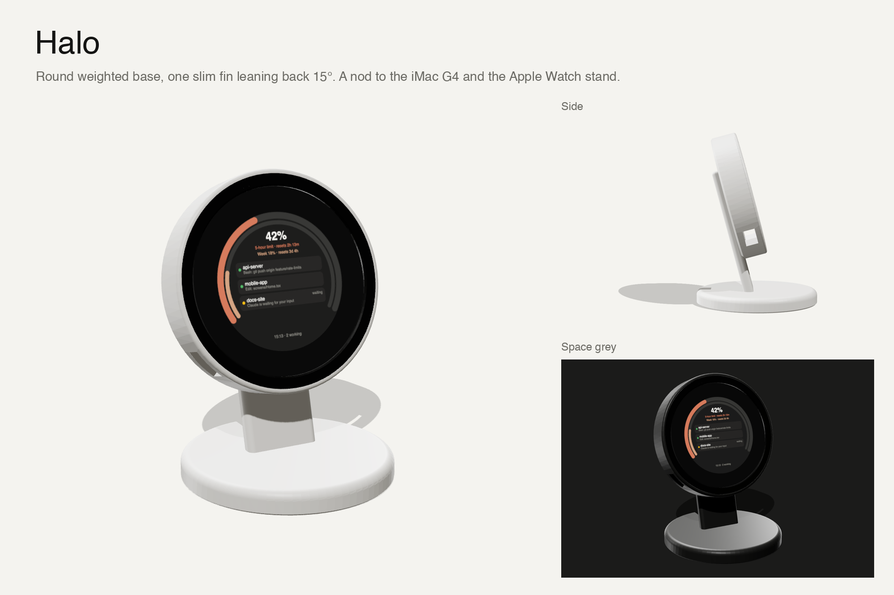
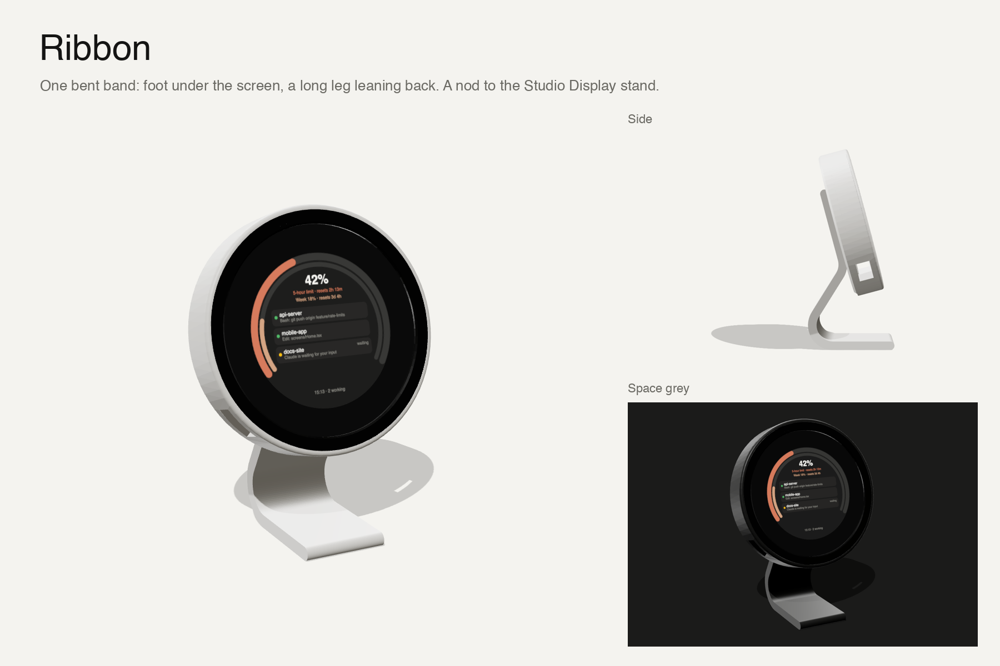

# Claude Dash desk cases

Two stand concepts for the Waveshare ESP32-S3-Touch-LCD-2.1. Both share one **puck** that holds the display, with a black **bezel ring** over the glass edge. Everything prints without supports on a Bambu Lab A1 mini.

| Halo | Ribbon |
|---|---|
|  |  |
| Round base and one slim fin leaning back 15°. Heavier, very stable. | One bent band: foot under the screen, leg leaning back. Lighter, more sculptural. |

The puck sits about 3 cm above the desk. That leaves room for a USB-C cable: the board's two ports point diagonally down from its bottom corners, and the puck has a slot at each one.

## Files

| File | Print as | Size (mm) | Settings |
|---|---|---|---|
| `stl/fit_test.stl` | as is | 86 × 86 × 5.6 | **print this first**, about 15 min |
| `stl/puck.stl` | back down | 86 × 86 × 17.6 | 0.2 mm, 3 walls, 15% gyroid |
| `stl/ring.stl` | front face down | 82 × 82 × 1.6 | 0.12 mm, 100% infill; black |
| `stl/halo_stand.stl` | base down | 84 × 84 × 91 | 0.2 mm, 3 walls, 40% infill (heavier = steadier) |
| `stl/ribbon_stand.stl` | on its side | 93 × 50 × 30 | 0.2 mm, 4 walls, 40% infill; 3 bumper recesses under the foot |

- **`3mf/claude_dash_ribbon_kit.3mf`: the whole Ribbon on one A1 mini plate, ready to slice.** The puck (back down) and ring (front down) are at the back, and the stand lies on its side at the front. Give the ring black filament (with AMS lite), or delete it from this plate and print it separately in black.
- `3mf/claude_dash_halo.3mf` and `3mf/claude_dash_ribbon.3mf` hold each concept's parts in print orientation, but not arranged on a plate.
- `step/*.step` are the same parts for editing in Fusion, Onshape or FreeCAD.
- No supports anywhere. PLA or PETG; matte white or grey PLA looks the most "Apple".

## Before printing: check the fit

Waveshare's drawing gives the glass diameter (75.00 mm), the visible area (53.28 mm) and the board width (66.00 mm), but **no thicknesses**. Two values in `claude_dash_case.py` are estimates:

- `MODULE_DEPTH = 11.0` is the distance from the glass front to the tallest part on the back. Measure it with calipers.
- `PORT_Z = 7.0` is the distance from the glass front to the centre of the USB-C ports.

Print `fit_test.stl` (front 5.6 mm of the puck):
1. The display should drop in from the front without force and without wobble. If it's tight or loose, change `FIT` (default 0.30 mm).
2. The ring should press in and stay. If it's loose, lower `RING_FIT`; if it's too tight, raise it.

Then rebuild:

```bash
python3 -m venv .venv && .venv/bin/pip install build123d
.venv/bin/python claude_dash_case.py
```

## Assembly

1. Put the display into the puck from the front, with the USB-C ports at the bottom, so they line up with the two slots.
2. Press the ring in. If it isn't snug, add a drop of glue at three points.
3. **Magnets (optional):** two 6 × 2 mm disc magnets in the puck's back and two in the stand, with matching polarity. Or skip the magnets and glue the puck to the stand. The slot on the back of the puck locates it.
4. Plug a USB-C cable through the slot into the **USB** port: the one at the bottom right as you look at the screen. The plug's body must be at most 13 × 7.5 mm, which most cables are.
5. **Ribbon:** press three **10 mm round silicone bumpers** (the clear self-adhesive kind, 2–3 mm tall) into the recesses under the foot. Two go at the front and one at the back. The stand is light, and the bumpers stop it sliding when you tap the screen.

The right edge of the puck has two pinholes, for **BOOT** and **RESET** (use a SIM tool), plus a slot for the battery switch.

## Rendering

`render/view.html` shows the assemblies with three.js:
1. Run `python -c "import claude_dash_case as c; c.export_render_meshes('render/meshes')"`.
2. Serve `render/`, e.g. `python3 -m http.server --directory render`.
3. Open `view.html?concept=halo&view=front34`. Other values: `concept=ribbon`; `view=side|front|back34`; add `dark=1` for a dark background.
